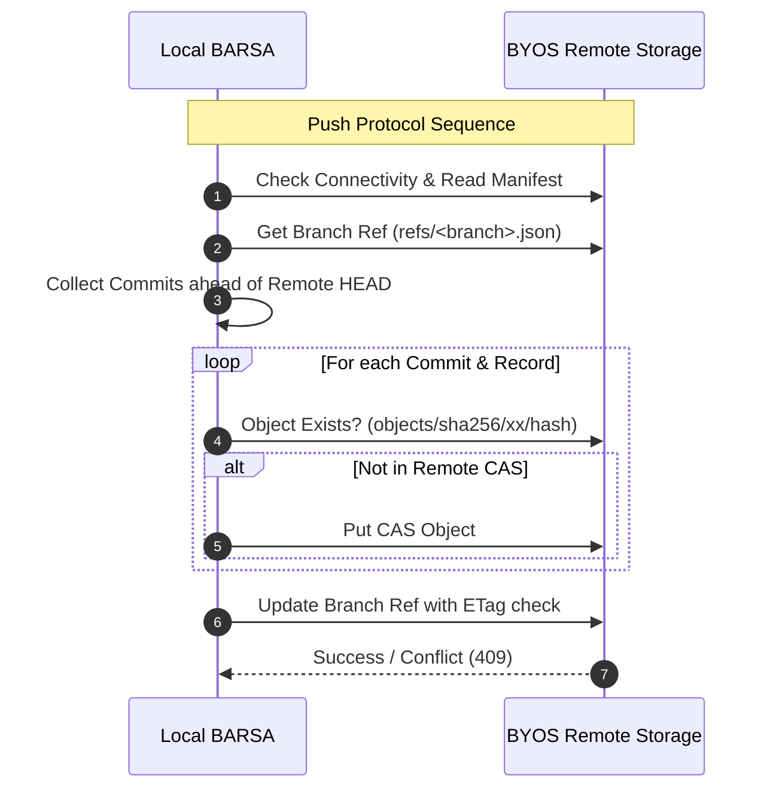
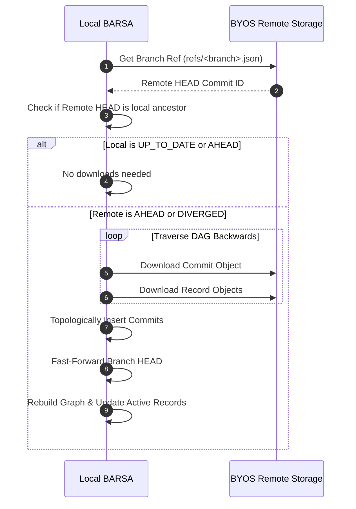

# BARSA Cloud Synchronization Protocol

## 1. Protocol Overview

The BARSA synchronization protocol defines the wire format, state transitions, and transfer sequences between a local BARSA installation and a remote BYOS repository.

---

## 2. Push Protocol Sequence

1. **Connectivity Check**: Adapter issues a lightweight probe (`head_bucket` or directory access check).
2. **Manifest Verification**: Read and validate `repository.json`. If missing, the remote is automatically initialized with repository metadata and format version `1.0`.
3. **Reference Discovery**: Fetch the current `RemoteBranchRef` for the target branch (`refs/<branch>.json`).
4. **Ancestry & Divergence Verification**:
   - If `remote_head` exists, verify whether `remote_head` is an ancestor of `local_head`.
   - If `remote_head` is not in local commit history and `force=False`, abort with `ConflictError(diverged)`.
5. **CAS Upload**:
   - Commits are serialized into canonical JSON bytes.
   - Referenced BMS records are collected from `commit_record_states`.
   - Each payload is hashed using SHA-256 and uploaded if not already present in remote CAS.
6. **Atomic Reference Update**:
   - The remote branch reference `refs/<branch>.json` is written conditionally using the expected ETag.
   - If an unexpected update occurred concurrently on the remote, the push fails with `ConflictError`.
7. **Local State Commit**:
   - Update `remote_refs` and `sync_state` tables in local SQLite.
   - Record entry in `sync_history` with transfer counts, duration, and commit IDs.

---

## 3. Pull Protocol Sequence

1. **Remote Ref Fetch**: Fetch `refs/<branch>.json` to identify `remote_head`.
2. **Short-Circuit Check**: If `local_head == remote_head`, mark status as `UP_TO_DATE` and exit immediately.
3. **DAG Traversal**:
   - Queue `remote_head` and traverse backwards via `parent_commit_ids`.
   - Stop traversal at commits already present in local SQLite.
4. **CAS Download**:
   - Download missing commit JSON objects from `objects/sha256/<hash[:2]>/<hash>`.
   - Validate received bytes match `hash` (tamper protection).
   - Download all referenced records and insert into `bms_records` and `checkpoints`.
5. **Topological Insertion**:
   - Insert downloaded commits into `commits`, `commit_parents`, and `commit_record_states` in root-first topological order.
6. **Fast-Forward & Projection**:
   - If lowest common ancestor is `local_head`, advance local branch pointer to `remote_head`.
   - If FalkorDB knowledge graph is enabled, trigger projection update for `remote_head`.

---

## 4. Status Comparison Matrix

| Local vs Remote DAG Relationship | Status Code | Recommended Action |
|:---|:---|:---|
| `local_head == remote_head` | `UP_TO_DATE` | None; synchronized |
| `local_head` is descendant of `remote_head` | `AHEAD` | Push local commits to remote |
| `remote_head` is descendant of `local_head` | `BEHIND` | Pull remote commits (fast-forward) |
| Neither is ancestor of the other | `DIVERGED` | Merge locally or push with force |
| Remote branch does not exist | `AHEAD` | Initial push to establish branch |
| Authentication / Network failure | `ERROR` | Verify credentials & connectivity |
