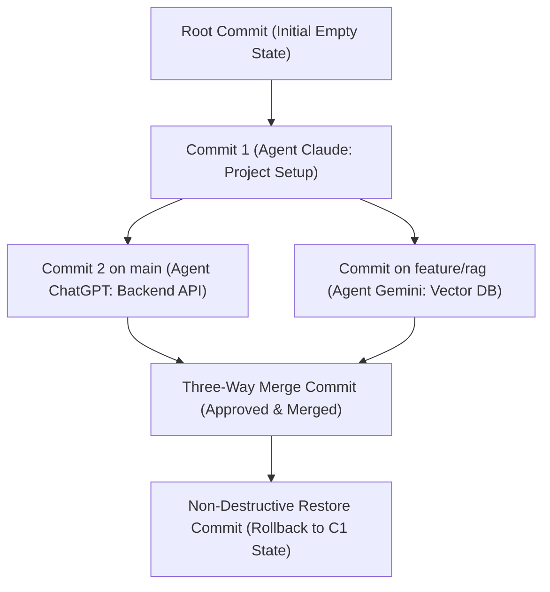

# BARSA Phase 4: Git-Style Memory Version Control Engine Architecture

## 1. Overview

Barsa Phase 4 implements a provider-independent, deterministic, Git-inspired version control engine for structured AI working memory (Barsa Memory Standard v0.1).

Rather than storing unstructured text logs or shell-calling Git CLI, Barsa manages a native Directed Acyclic Graph (DAG) of memory commits stored directly within the local-first SQLite database.

---

## 2. Core Concepts & Invariants

1. **Deterministic Content Hashing:**
   Every commit receives an immutable 64-character SHA-256 identifier calculated by canonically formatting project ID, sorted parent commit IDs, author metadata, UTC timestamp, sorted record changes, resulting state hash, metadata, and BMS version.

2. **Branch Management:**
   - Every project starts with a protected `main` branch pointing to a root commit.
   - Deletion of the `main` branch is rejected with `409 Conflict`.
   - Feature branches branch off any commit in the DAG without interfering with other branches.

3. **Compare-and-Swap (CAS) Concurrency:**
   - Commits can specify `expected_head_commit_id`.
   - If another agent or user has advanced the branch HEAD since it was last read, the commit is atomically rejected with `409 Conflict ("Stale HEAD on branch...")`.

4. **O(1) Historical State Reconstruction:**
   - Instead of traversing and replaying all commits from root, each commit transaction records an immutable index row in `commit_record_states`.
   - Historical time-travel and rollbacks retrieve states in $O(1)$ database queries.

5. **Three-Way Merge Engine:**
   - Automatically discovers the Lowest Common Ancestor (LCA) in the commit DAG via BFS.
   - Merges independent additions/updates and identical modifications cleanly.
   - Identifies conflicts:
     - `SAME_FIELD_UPDATE`: Both branches modified the same JSON Pointer path to different values.
     - `DELETE_VS_UPDATE`: One branch deleted a record while the other branch updated it.
     - `RECORD_COLLISION`: Both branches concurrently created different records with the same identifier.
   - All conflicts are explicitly persisted in SQLite and must be formally resolved prior to merge execution. No heuristic or LLM hallucinations are permitted during conflict resolution.

6. **Non-Destructive Rollbacks (Time Travel):**
   - Restoring to a historical commit does not delete any commits or rewrite DAG history.
   - It computes the state diff from current branch HEAD to the target historical commit and creates a new forward-advancing restore commit.
